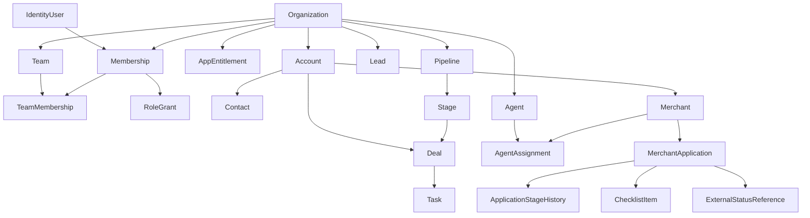

# P1.07 — Domain Relationships, Referential Integrity and Tenant-Safe Joins

**Version:** 1.0 — OWNER-APPROVED PROVISIONAL RELATIONSHIP DESIGN · 2026-11-13  
**Status:** P1.07 owner-approved provisional planning design only; **no schema/migrations/SQL policies/code or relationship tests exist yet**.  
**Source:** [31-entity Glossary](domain-glossary.md), [230-field dictionary](domain-dictionary.csv), [P1.06 access matrix](../security/permission-matrix.md).  
**External use:** NOT authorized; only synthetic sample records permitted.

## 1. Domain boundaries and candidate cardinalities

| Parent | Child / related entity | Candidate cardinality | Integrity constraint | Authorization implication | Negative case |
|---|---|---|---|---|---|
| Organization | Membership | 1:N | Membership.organization_id = Organization.id | Membership.user_id global verified identity; active role required | No cross-org membership reuse, no last-owner removal |
| IdentityUser | Membership | 1:N | Membership.user_id = IdentityUser.id | Global identity not permission; membership gates resource | Unknown or suspended user denied |
| Organization | Team | 1:N | Same organization_id | Team visibility by org and management grant | Foreign teams denied |
| Team | TeamMembership | 1:N | Same organization_id and active membership_id | Team membership required for team row scope | Revoked team member loses access |
| Membership | RoleGrant | 1:N | Same organization_id, membership_id and authorized grantor | Grant only assignable roles, no self-escalation | Unapproved role denied |
| Organization | AppEntitlement | 1:N | Same org, unique app_key per active grant | Backend enforcement of app availability | Unentitled mutation denied |
| Organization | SubscriptionReference | 1:N | Same org; opaque provider reference only | Demo mocked billing not actual charges | Raw payment/bank fields denied |
| Organization | AuditEvent | 1:N | Same org and actor/correlation refs | Append-only safe metadata | Client direct audit rewrite denied |
| Organization | Pipeline | 1:N | Same org | Pipeline scope lead|deal | Cross-org stage refused |
| Pipeline | Stage | 1:N | Same org and pipeline ID | Stage belongs to selected same-org active pipeline | Invalid stage pipeline denied |
| Organization | Lead | 1:N | Same org plus active assigned owner | Owner/team/record scope required | No global lead lookup |
| Organization | Account | 1:N | Same org plus record owner | Business CRM account only | No real bank/processor account encoded |
| Account | Contact | 1:N | Same org on both sides | Contact association within permissible account | Foreign account ID denied |
| Lead | Deal | 0..N | Same org and explicit conversion relation if introduced | Conversion not silent merge | Deal won does not imply merchant approved |
| Account | Deal | 1:N | Same org, deal.account_id | Deal owner/team and active pipeline constraints | Cross-tenant account ref denied |
| Deal | Task | 0..N | Task parent_kind=deal, same org and permitted parent | Assignee must be active same-org member | No unauthorized task assignment |
| Lead | Task | 0..N | Task parent_kind=lead, same org and parent policy | One active task may need owner/due date | No dangling foreign parent |
| Account/Lead/Deal | Activity | 0..N | Parent kind/ref resolves same org | No raw sensitive notes in timeline | No cross-org activity disclosure |
| Organization | Agent | 1:N | Agent.organization_id = Organization.id | Agent is internal business entity, not user login | Agent record cannot authenticate |
| Organization | Merchant | 1:N | Merchant.organization_id = Organization.id | Minimal business metadata, no sensitive onboarding documents | No raw MID/account numbers |
| Account | Merchant | 0..N | Same org optional account_id | Internal CRM handoff only | Not actual processor account |
| Merchant | MerchantLocation | 1:N | Same org and merchant_id | Permitted fictional display location | No identity/address file |
| Agent | AgentAssignment | 1:N | Same org and active manager | Old assignment retained for audit | Revoked agent relationship stops visibility |
| Merchant | AgentAssignment | 0..N | Same org and agent_id | Only authorized current links grant scope | Former agent cannot enumerate old merchant |
| Merchant | MerchantApplication | 1:N | Same org; owner active membership | Internal tracking application only | No underwriting request or processor submission |
| MerchantApplication | Task | 0..N | Task parent_kind=merchant_application, same org | Track next action and owner consistently | No orphan stage/task after failed transaction |
| MerchantApplication | ApplicationStageHistory | 1:N | Same org, append only by authorized stage transition | Optimistic expected version + audit | No direct edit/delete by end users |
| MerchantApplication | ChecklistItem | 0..N | Same org and application_id | Non-sensitive task category only | Checked item never sets external approval |
| MerchantApplication | ExternalStatusReference | 0..1 | Same org; restricted read-only provenance relation | DEMO_ONLY_* synthetic unverified in MVP | Actual verified source needs future signed adapter |
| Organization | ImportJob | 1:N | Same org; importer membership allowed | Allowlisted CSV only and safe validation | Reject forbidden columns before persistence |
| Organization | ExportJob | 1:N | Same org; exporter has distinct E grant | Rows/fields constrained by current ACL | Revoked export access denied |
| Organization | OutboxEvent | 1:N | Same org; opaque event ref only | Later worker must use narrow machine principal | No wildcard system-worker access |
| Organization | ProviderEvent | 1:N (DEFERRED) | Approved provider contract, signature + same org | No live connector allowed in current release | Unsigned/replayed events denied |

These are conceptual constraints for future Prisma/DB modeling, not a fixed production schema. Some optional associations, status references, team/agent hierarchy rules and stage names are **provisional** because three merchant workflows were not validated with actual operators (P0.05 0/3).

## 2. Minimum tenant-safe integrity contract

- Every **TENANT_SCOPED** row must have a required immutable `organization_id` linked to its Organization and validated on every read/write/query/worker action.
- For all parent→child associations with tenant records, verify both have the **same** organization; design Prisma+Postgres foreign keys/unique constraints to prevent cross-tenant associations where practical. An FK to only an unscoped globally unique `id` is **not** sufficient policy by itself.
- Select verified organization from *active server-side membership*, not from user-supplied organization IDs. A global IdentityUser has no automatic tenant access.
- Base resource visibility on current owner/team/agent assignment and field allowlist; a tenant check alone does not authorize all rows.
- Reports and exports apply row/field policy before aggregation and materialization. Background jobs receive explicitly scoped org/principal context.
- Invalidate cached grants after membership/team/agent revocation no later than the next protected server request; preserve historical assignments only for authorized auditors.
- Protect final active tenant owner; role escalation requires approved grantor and may not happen through record field edits.
- Keep `ApplicationStageHistory` append-only from atomic authorized transitions, with expected-version/idempotency behavior; no generic UPDATE/DELETE privilege.
- Internal application stage changes, won deals and checklist completion **never** verify actual provider approval, boarding, activation, charges or payouts.
- ProviderEvent is explicitly **DEFERRED** and may not be implemented as a real processor input without contracted authorization, signatures, idempotency, safe provenance and security review.
- Never add restricted financial/ID/KYC/token fields to generic CRM, attachments, logs, search, exports or seed data; use approved provider-hosted alternatives only if separately permitted.

## 3. Candidate entity relationship overview

This diagram shows **conceptual relationships**, not actual database tables or automatic bridging to real payment processors.

## 4. Optionality and lifecycle examples

**Lead/Account/Deal:** A lead can be created before a linked account; a deal must reference an authorized account and sales pipeline. Converting a lead may produce a deal but cannot silently merge contacts or establish a real merchant account.

**Merchant:** A merchant may be linked to a same-org CRM Account after a sales handoff. A merchant may have multiple internal applications, but uniqueness, duplicate detection and processor-specific semantics remain an open P1.07/P8 design decision.

**Application next action:** A single next-action string is an internal state snapshot; tasks have their own assignments and due dates. A stage change plus audit/history and task update must be transactionally consistent once code exists.

**External status:** A demo application may point to a fictional `ExternalStatusReference` with `verification_state=synthetic_unverified`. This value does not permit real provider status mutation, live payments or activation.

**Soft archive vs delete:** Initial permission matrix defines no direct hard-delete permission. Archiving and regulated retention/deletion have separate future security/privacy lifecycles and jurisdiction-specific review.

## 5. Data contract decisions carried into P1.08/P3

- Whether to use UUIDv7/ULID or another opaque ID and exact OpenAPI syntax (**not frozen**).
- Composite org-aware FK/unique constraints for parent/child relations and tenant isolation (**to implement**).
- Exact role/team/agent granting and access-revocation cache consistency implementation.
- Final stage/enum allowed values and state transition config after real-world workflow validation.
- Explicit import staging/file scanning, export link expiry, audit retention and provider attachment design.
- Testing of invalid parent IDs, cross-tenant associations, double-writes, stale versions and auth denial before external data access.

## 6. Verification gate

The companion [domain-validation-cases.csv](domain-validation-cases.csv) defines future tests, including tenant FK mismatches, revocation, state independence, forbidden field rejection and safe serialization. **No tests have run.** P1.07 owner-approved as provisional domain design on 2026-11-13; P1.08 API/Event Contracts is active in issue #21.
