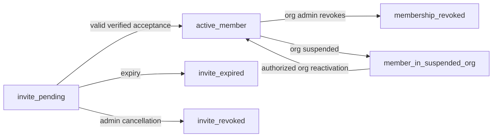
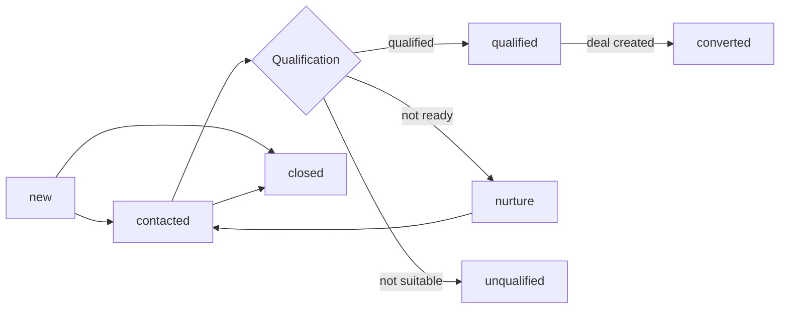
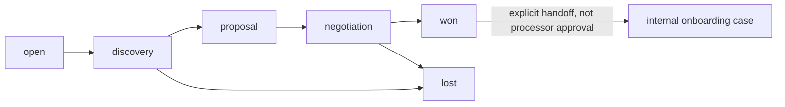
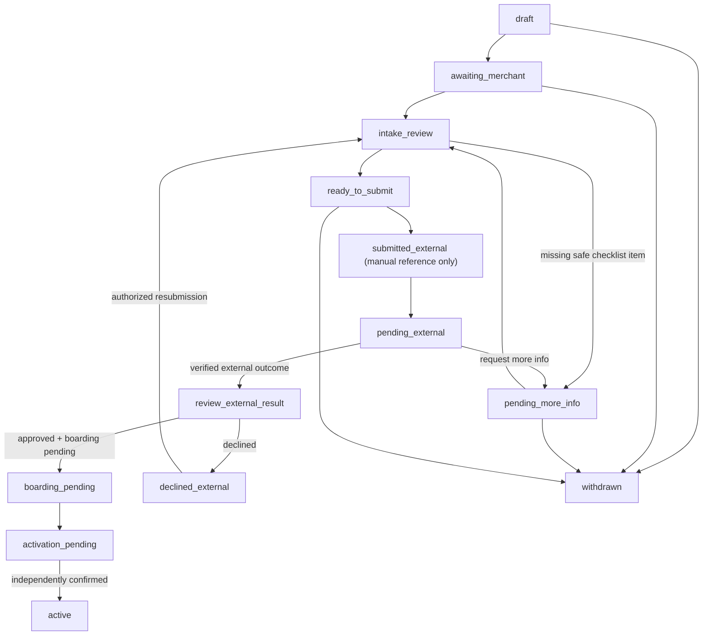

# P1.02 — Proposed State Transitions, Invariants, and Recovery

**Prepared:** 2026-11-13
**Version:** v0.1 — P1.02 review draft
**Status:** Speculative internal workflow design only. **P0.05 was owner-waived with 0/3 real-world merchant workflows validated.**
**Scope:** R0 organization/invitations; R1 lead/deal/task; R2 internal onboarding; future external provider references remain excluded from MVP.

## Core state separation

Four independent state dimensions must never be conflated:
1. **Organization/membership:** whether an actor may enter a workspace.
2. **Sales:** lead/deal and activity progress.
3. **Internal merchant application:** who owns the work and what is pending.
4. **External processor:** independently verified provider status **if and only if** an authorized adapter exists later.

An internal `stage=approved_external` string or checkbox is not proof of processor approval. An externally returned “approved” status is not proof that boarding, terminal activation, `charges_enabled`, or payouts are possible.

## A. Membership and organization context (R0)

| Transition | Proposed actor | Validation/invariant |
| --- | --- | --- |
| Create invite `none → pending` | Authorized org admin | Valid syntactic email, bounded roles, tenant-specific invite token and expiration |
| `pending → accepted/active` | Intended, verified identity | Same approved tenant and email/identity binding; atomic grant; single-use invite |
| `pending → revoked/expired` | Admin / expiration worker | Cannot accept a revoked/expired link |
| `active → revoked` | Authorized admin | Session/permissions reevaluated; prevent leaving org with no approved owner |
| `suspended → active` | Account authority (future policy) | No automatic access when payment status changes without explicit valid org state |

**Forbidden:** organization B's admin inviting/granting roles in A; signed-in user swapping `orgId` to see another org; self-assigning platform roles; an inactive member invoking tenant APIs. Active organization is server-verified per operation.

## B. CRM lead lifecycle (R1; adjustable)

Candidate state values: `new`, `contacted`, `qualified`, `unqualified`, `nurture`, `converted`, `closed`.

| Rule | Required behavior |
| --- | --- |
| Lead creation | Initial stage from tenant pipeline config; creator/owner and audit recorded |
| Qualification | Actor must have sales edit right and record scope; stage valid in active pipeline |
| Conversion | Creating a new Deal must not silently merge a Lead or skip relation validation |
| Closure/reopening | Specify reversible vs terminal stage policy and audit history in P1.07; not frozen now |
| Concurrency | Competing edits must use version/conflict protection and cannot silently lose work |

**Validation gap:** Qualified buyer/operators have not confirmed a universal ISO lead lifecycle. Configurable stages are required.

## C. Deal/pipeline lifecycle (R1; adjustable)

Candidate stage keys: `open`, `discovery`, `proposal`, `negotiation`, `won`, `lost`. Deal pipelines are organization-specific with ordered stage keys and allowed transitions.

- A `won` deal **may trigger an internal onboarding handoff proposal** but cannot imply a processing application has been submitted or approved.
- Losing a Deal can store an optional permitted lost-reason category, without copying sensitive merchant data.
- Reopening a won/lost deal requires an authorized explicit action and audit.
- Every move validates **active membership, record visibility, role permission, current version, stage in active pipeline**; disallowed move returns safe domain error with no partial history.

## D. Task lifecycle (R1/R2)

Candidate: `open`, `in_progress`, `blocked`, `done`, `cancelled`.

| Action | Proposed rule |
| --- | --- |
| Create task | Parent lead/deal/merchant/application is visible in same org; assignee is active member |
| Assign/reassign | Server permission check and audit; prev owner loses task-only rights if based on assignment |
| Mark blocked | Capture a non-sensitive next-action category and owner; internal-only |
| Complete | Authorized actor and valid current version; persist completion timestamp |
| Reopen | Only via explicit permitted move; preserve completion/reopen audit |

A failed task save does not count as completed. Retry with idempotency and re-check canonical task state.

## E. Internal merchant application lifecycle (R2; **NOT customer-validated**)

Candidate internal stages adapted from synthetic P0.05 maps, not processor contracts:

**This diagram is a discussion proposal.** A later implementation may store `externalStatus` separately from the internal stage, and it **must** do so for actual provider verification. A `submitted_external` internal label is a *tracking note*, not proof of a received processor request. Stage `review_external_result` must never be entered merely by setting an unchecked “approved” boolean.

### Proposed transition conditions

| Attempt | Minimum preconditions | Success outcome | Denied / recovery outcome |
| --- | --- | --- | --- |
| `draft → awaiting_merchant` | Valid merchant, assigned coordinator, allowed transition | New stage/history and next action | Missing merchant/owner → input error; no write |
| `intake_review → pending_more_info` | Authorized coordinator, specified allowed missing item | Blocker reason category, task, history | Prohibited identity attachment rejected |
| `pending_more_info → intake_review` | Missing-item task complete and reviewed | Checklist/history updated | Failed checklist remains blocked |
| `ready_to_submit → submitted_external` | Explicit human recording of handoff; no processor grant inferred | Internal tracking stage only | UI makes clear **unverified external receipt** |
| `pending_external → review_external_result` | Verified-authority external reference, or approved operator-review workflow | Separate external reference evidence, history | No arbitrary staff fake processor approval |
| `review_external_result → boarding_pending` | Confirmed processor approval source if implemented; otherwise remain review | Internal task assigned for boarding verification | No auto activation |
| `boarding_pending → activation_pending` | Separate boarding/MID confirmation as policy requires | Waiting for activation follow-up | No implicit charge/payout enablement |
| `activation_pending → active` | Verified activation evidence or future owner-approved manual attestation rule | Record timestamp/source, history and support handoff | No activation based on internal checkbox alone |
| Any permitted stage → `withdrawn` | Authorized operator, valid reason, policy-approved cancellation | History retained; pending tasks handled consistently | Do not purge audit or override external processor record |
| `declined_external → intake_review` | Explicit review/resubmission permission, historical external decision preserved | New review iteration/version | Prior decline not overwritten |

**Potential model improvement before code:** Use internal state `intake`/`blocked`/`tracking_external` and separate immutable `externalStatusReference` mapping rather than embedding provider decision names in internal stage keys. **P1.07 and future real operator research must decide**.

### Application invariants

- `application.org_id = merchant.org_id = agent.org_id = task.org_id` for relationships that exist.
- Only an authorized principal changes internal stage; provider status may only be updated through approved verified channel.
- Each stage transition carries actor, previous/new internal stage, reason category, timestamp and expected-version check.
- Stage update, next-task adjustments, audit and future outbox emission are atomic in database transaction where applicable.
- Client double click/retry cannot create duplicate stage history or two merchant applications for one logical idempotent request.
- Decline/withdrawal/reopen preserves prior stage history and provider evidence.
- If agent is removed, previous agent visibility is immediately invalidated even if historical assignment still stored.
- Dashboard counts include only applications the querying actor is allowed to view.
- External statuses are never transformed into claims that funds, cards or merchant activity are live without separately verified capabilities.

## F. Future external provider events (R2/LATER, **not MVP**)

A future provider connector must authenticate signed events, map only known allowlisted statuses, maintain idempotency keys and provider timestamps, quarantine ambiguous/out-of-order messages and preserve source provenance. **No live provider webhook credentials or endpoints exist today**, and no external callback may be synthesized as a real processor decision.

## G. Proposed domain errors and recovery

| Condition | Client behavior | Server invariant |
| --- | --- | --- |
| 401 expired session | Prompt to sign in; preserve allowed unsent form data | No tenant access |
| 403/404 inaccessible record | No record details; safe denied page | Do not reveal existence/owner |
| 409 version mismatch | Show current stage/owner; request user to reload/retry | No last-write-wins corruption |
| 422 invalid stage transition | Show allowed next action and reason (permission-filtered) | Previous stage/history unchanged |
| 429 request throttled | Present retry guidance | No duplicate logical action |
| 503 provider unavailable (future) | Label external status unknown/stale, don't claim approval | No fabricated processor update |
| Import row failed | Safe field-level error summary | No silent partial import |
| Quarantine file scan fails | Deny file access/release | Never treat scan failure as safe |
| Duplicate event | Acknowledge idempotently with no new state mutation | At-most-one effective state application |

Error HTTP mapping and UI wording are **drafts**; P1.08 will define the final API contract. No implementation or runtime tests have been run.

## H. Validation backlog

- [ ] Confirm real ISO, POS reseller and PayFac workflow variants (P0.05: 0/3; research issue #8 still open).
- [ ] Confirm pipeline defaults, terminal and reversible stages with owner.
- [ ] Establish full actor + record policy matrix in P1.06.
- [ ] Establish glossary, exact types/lengths and status normalization in P1.07.
- [ ] Define API/event/response schema contracts in P1.08.
- [ ] Implement and execute automated state/tenant/idempotency tests only in later engineering phases.
- [ ] Product owner approves this as an editable planning baseline for P1.02.

**Status: DRAFT READY FOR REVIEW; no state machine exists in code.**
