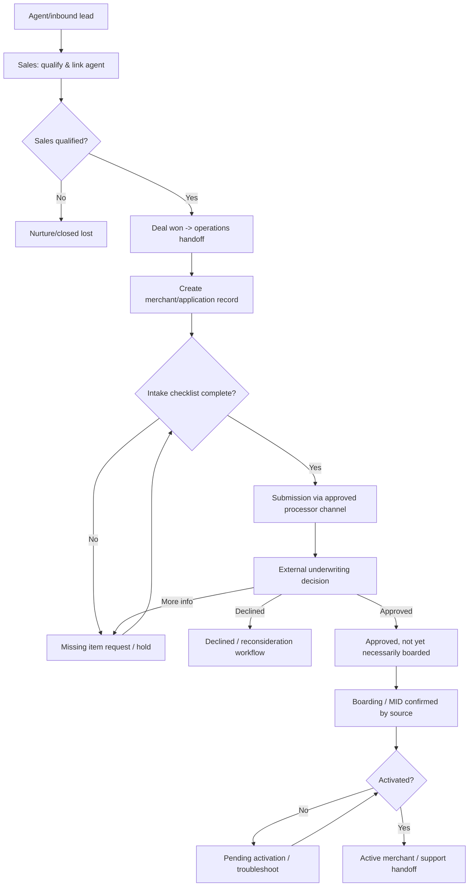
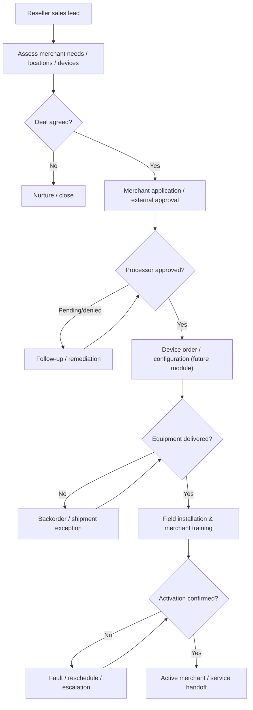
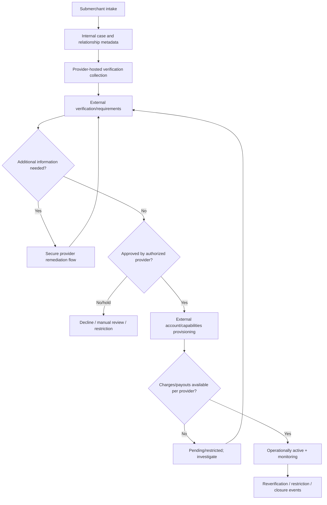

# P0.05 — Merchant Process Maps

**Prepared:** 2026-11-13
**Status:** OWNER-APPROVED DRAFT as planning baseline on 2026-11-13; synthetic and **NOT customer-validated**. Phase P0.05 remains OPEN until 3 actual workflows are verified.
**Phase issue:** https://github.com/owaisprog/Zoho-Clone/issues/7
**Research issue:** https://github.com/owaisprog/Zoho-Clone/issues/8

## Boundary and terminology
We are building **Zoho Clone**, initially a merchant-operations **tracking/CRM** app, not an acquirer or payment processor. Distinguish:
- Internal owner/stage/checklist status (ours) from verified **external provider** underwriting/boarding status.
- Approved vs. boarded vs. gateway/terminal **activated**: these are separate milestones.
- Hosted processor/KYC collection from our minimal tracking metadata. No PAN, CVV, raw bank details, identity documents, processor credentials or private underwriting data in ordinary CRM records.
- Every business entity requires future `organization_id` isolation, membership, permission and audit controls.

All steps, actor roles and statuses below are **hypotheses requiring actual owner/processor review**.

## WF-ISO-01 — ISO lead through merchant activation

| Lane / actor | Handoff | Owning system | Rights proposal |
| --- | --- | --- | --- |
| Sales/agent | Lead, relationship, proposal | CRM P5 | Own/shared records |
| Sales manager | Deal stage/won handoff | CRM P5 | Authorized team pipeline |
| Onboarding operations | Merchant, application and checklist | Merchant Ops P8 | Assigned applications and internal status |
| External processor | Underwriting, MID, approval | External, **not MVP** | Provider-owned; verified integration in P7/V1+ |
| Support | Post-activation tickets | Help Desk future | Authorized related merchant only |

**Exception cases:** duplicate merchant; conflicting agent assignment; missing documents; processor returned for more data; decline/reapply; approved but not boarded; MID present but not live; delayed/repeated webhook; manual status update without proof; withdrawal. Preserve all transition histories.

**Proposed internal states:** draft, awaiting_merchant, intake_review, ready_to_submit, submitted_external, pending_external, pending_more_info, approved_external, declined_external, boarding, activation_pending, active, withdrawn. Final enum/transition graph pending validation.

**Entities:** Lead, Account, Contact, Deal, Agent, Merchant, MerchantLocation, MerchantApplication, ApplicationHistory, ChecklistItem, Assignment, ExternalStatusReference, Task, AuditEvent.
**Planned UI:** CRM deal, merchant detail, application queue/detail, stage/checklist, team reports and activity.
**Planned API:** `/api/v1/crm/leads`, `/api/v1/crm/deals`, `/api/v1/merchant-ops/merchants`, `/api/v1/merchant-ops/applications`, `/api/v1/merchant-ops/applications/:id/transitions`.
**Permissions/tests:** Tenant scoping, stage guards, immutable history, idempotent external event processing, unauthorized access denied.
**Possible KPI:** lead-to-submission, time waiting for docs, time pending processor, approval-to-activation.

## WF-POS-01 — POS reseller merchant setup and installation

**Actors:** reseller sales, merchant onboarding ops, external processor, equipment supplier, technician, support.
**Exceptions:** split shipment, lost/wrong hardware, multiple locations, technician no-show, processor decline after ordering, terminal setup failure, return/replacement, activation blocked.
**Data:** Shared Merchant/Account/Application; later DeviceOrder, Device, Shipment, InstallationTask, SiteActivation, ServiceTicket.
**MVP vs future:** CRM, merchant tracking and tasks in P5/P8; stock, hardware identifiers, shipping/field schedule and live POS transactions are **not MVP** and belong to separate later modules.
**Candidate future API:** `/api/v1/pos/deployments`, `/api/v1/pos/devices`, `/api/v1/pos/installations`.
**Validation:** Determine whether approval must precede device orders, who owns installation, and which signal really proves activation.

## WF-PAYFAC-01 — PayFac submerchant compliance and enablement

**Actors:** PayFac product operations, merchant, provider-hosted KYC/KYB service, underwriting/risk, support/security.
**Exceptions:** missing owner verification; pending manual review; account restriction after initial approval; capabilities inactive; payout hold; webhook replay; incomplete KYC, revoked access.
**Critical distinction:** Generic CRM `approved` does not imply `charges_enabled`, `payouts_enabled` or any universal provider status. Normalize only approved/supported provider fields with provenance.
**Data:** minimal internal case, provider account reference, verification requirement **status** (not raw personal docs), capability status history, integration event inbox, audit.
**MVP vs future:** P8 tracks internal applications only. PayFac verification/capability integrations require later specialist legal, security, processor contracts and integration rights.
**Future screens/APIs:** case queue, provider-status viewer, requirement exceptions, audit; `/api/v1/payments/submerchant-cases` after explicit scoping.
**Validation:** Who performs regulatory checks, which provider status fields are available, data residency and retention, and what counts as live.

## Shared eventual data/events and cross-app controls

| Change | Candidate event | Required safeguards |
| --- | --- | --- |
| Deal won | `crm.deal.won.v1` | Verified tenant and authorized actor |
| Application created | `merchant.application.created.v1` | Tenant-bound record IDs |
| Internal stage changed | `merchant.application.stage_changed.v1` | Atomic history, audit and outbox |
| External processor status received | `processor.application.status_received.v1` | Signed delivery, idempotency, provenance, out-of-order handling |
| Activation confirmed | `merchant.activation.confirmed.v1` | Evidence source and permissions |
| POS deployment completed | `pos.deployment.completed.v1` | Event only when future POS module exists |

All eventual records need tenant isolation, record-level permissions, secure file references, event schema versions, auditable decisions, and recovery/error states. **No code or tests have been executed at P0.05.**

## Validation gate and owner actions

- [x] 3 distinct **draft** workflows with swimlanes, roles, exceptions, future data and API boundaries.
- [x] Owner approved the three draft maps as **provisional planning models** on 2026-11-13. This approval is not evidence of real-world process accuracy.
- [x] Source-supported general processing steps separated from hypotheses.
- [ ] ISO operator validates a real recent lead-to-activation journey.
- [ ] POS deployment operator validates a real recent installation/activation journey.
- [ ] PayFac operator validates a real recent submerchant verification journey (or owner-approved alternative distinct workflow).
- [ ] Record changes, disagreements and exception paths from real evidence (private notes, public sanitized summaries).
- [ ] Product owner approves the **three validated workflows**.

**P0.05 remains OPEN.** Customer-validation evidence: **0/3**.

## Official source anchors
- NMI: https://www.nmi.com/products/merchant-central/merchant-signup-onboarding/
- NMI boarding: https://www.nmi.com/products/merchant-central/merchant-boarding/
- NMI API: https://docs.nmi.com/reference/getting-started
- Clover onboarding/permissions: https://docs.clover.com/dev/docs/app-onboarding-for-merchants
- Clover partnership prerequisites: https://docs.clover.com/dev/docs/application
- Stripe Connect capability fields: https://docs.stripe.com/api/capabilities/update

Vendor descriptions are **not** direct customer interview evidence or proof of an available integration agreement.
