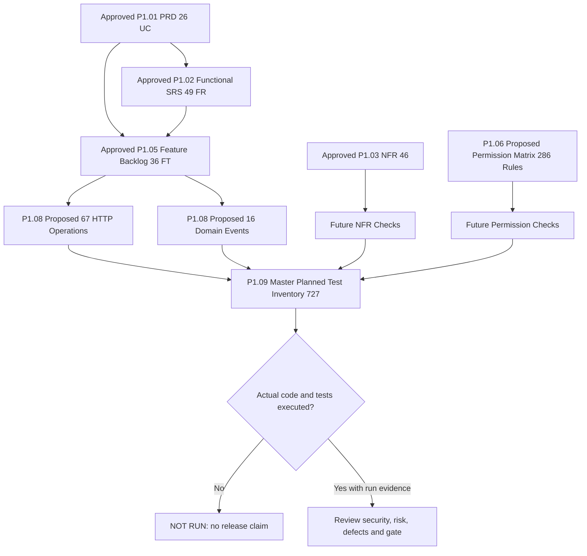

# P1.09 — Acceptance and End-to-End Requirements Traceability

**Version:** 1.0 — OWNER-APPROVED PLANNING BASELINE · 2026-11-13  
**Phase:** P1.09 Acceptance and Traceability Map · [Issue #22](https://github.com/owaisprog/Zoho-Clone/issues/22)  
**Prerequisites:** P1.01–P1.08 owner-approved **design baselines**, including P1.08 approved as API/event contracts **not implemented endpoints or running events**.  
**Execution status:** **ZERO executed tests; ZERO proven passes; ZERO working application deployments.**  
**Authorization:** Internal synthetic-only sequencing under P0.10; real customer data, processor integration, external pilots and commercial production **NOT AUTHORIZED**.

## 1. Purpose and working definition of coverage

P1.09 provides a verifiable *paper trail* from business need to implementation feature, API/event/policy contract, and future acceptance checks. It does **not** prove any security property, performance target, market demand, payment processing compliance, user journey or functional behavior.

**Planning coverage:** A requirement is "PLANNED_TESTS_EXIST_NOT_RUN" if it has one or more distinct, source-linked future test IDs.  
**Implementation coverage:** A requirement is *implemented* only after code and runtime behavior exist in an actual controlled environment.  
**Executed-test coverage:** A requirement is *tested* only after real CI/local run evidence (date, environment, commit, command, logs, test result and defect references) exists.  
**Release readiness:** A product slice is *accepted* only after its required implemented behaviors and mandatory negative/security/NFR evidence have been reviewed and explicitly approved; neither design approval nor green status in a CSV is enough.

## 2. Source-of-truth matrix and coverage snapshot

| Coverage layer | Sources | Count | Current truth |
|---|---|---:|---|
| PRD use cases | [P1.01 release matrix](../product/prd-release-matrix.csv) | **26** | All map to features and at least one planned test; some are deliberately deferred |
| Functional SRS | [P1.02 requirements](../product/srs-requirements.csv) | **49** | All map to future cases; not implemented |
| Nonfunctional SRS | [P1.03 NFR matrix](../product/nfr-matrix.csv) | **46** | All map to proposed future verification; no measured benchmarks or restore evidence |
| Features | [P1.05 backlog](../product/mvp-backlog.csv) | **36** | All have a future test connection; indirect links do **not** equal feature-specific automated checks |
| API operations | [P1.08 OpenAPI](../api/openapi-v1.json), [API trace](../api/api-traceability.csv) | **67** | 44 proposed paths, 72 schemas; API is NOT RUNNING |
| Internal events | [P1.08 catalog](../api/event-catalog.csv) | **16** | Only designed; no producer, outbox, queue, subscriber or delivered event |
| Permission decisions | [P1.06 role/resource matrix](../security/permission-matrix.csv) | **286** | 69 proposed allowed rows, 217 default-deny; not enforced in code |
| Planned acceptance tests | [Master inventory](test-inventory.csv) | **727** | ALL marked `NOT_RUN_DOCUMENT_ONLY` |
| Actual test executions | No executable application/test run logs | **0** | **No observed test result, security audit or certification** |

[Requirement coverage table](requirements-coverage.csv): **121 of 121** PRD UC/Functional FR/NFR rows have planned-test references.  
[Feature coverage table](feature-coverage.csv): **36 of 36** feature rows have at least one linked planned-test reference. These are *planning links*—often shared UC/FR cases—not evidence that every independent feature behavior is completely specified or tested.

**API coverage limit:** Direct HTTP routes map **18 of 26** PRD UCs and **37 of 49** Functional FRs. `UC-106` is UI/error/recovery; `UC-208` is QA/synthetic fixtures; `UC-301`–`UC-306` are later specialist/full-suite capabilities. Corresponding non-route FRs must remain traced to UI/QA/policy/deferred acceptance, never fabricated REST endpoints.

## 3. Master test inventory: 727 planned test cases

| Source suite | Planned cases | Main scope |
|---|---:|---|
| [Functional SRS](../product/srs-acceptance-cases.csv) | 59 | Business behavior, validation and stage transitions |
| [Nonfunctional SRS](../product/nfr-acceptance-cases.csv) | 52 | Performance, backup, security, accessibility/reliability budgets |
| [Journey](../product/journey-acceptance-cases.csv) | 36 | User paths, failures and handoffs |
| [Permission negative tests](../security/permission-negative-cases.csv) | 52 | Cross-org, revoked members, privilege escalation, export and field safety |
| [Domain](../product/domain-validation-cases.csv) | 46 | Entity integrity, tenant association, forbidden fields |
| [API](../api/api-contract-cases.csv) | 164 | 134 route positive/negative cases and 30 cross-cutting/deferred cases |
| [Role/resource decision table](permission-decision-cases.csv) | 286 | One proposed decision-based test per permission matrix row |
| [Event](event-acceptance-cases.csv) | 32 | Two future tests per internal event: valid scoped envelope; invalid/replayed/unsafe input |
| **TOTAL** | **727** | **Every case unexecuted** |

The [Master test inventory](test-inventory.csv) retains original test IDs, source paths, suite, related UC/FR/NFR/feature/API IDs when available, scenario and expected result. Duplicate IDs are forbidden; a planned case may serve more than one requirement. **Tests without explicit requirement IDs (e.g., permission decision-table cases) remain policy-design linked, not artificially assigned to an arbitrary FR.**

## 4. Requirements-to-test flow

**All sources above are specifications.** A feature, permission or test appearing on this diagram does not mean the capability exists.

## 5. How future test evidence must be recorded (P3 onward)

Each actual run must capture:
- **Test identity**: stable `test_id` from this register (and implementation file/test-case path), associated requirement and release.
- **Code identity**: exact Git commit/branch/CI run URL, test fixture version, runtime/DB/provider mock environment and schema migration hash.
- **Execution**: timestamp, command/tool runner, actual result `PASS|FAIL|BLOCKED|SKIPPED`, assertion log, redacted evidence URI and defect issue reference.
- **Ownership**: engineer/test reviewer and, for actual release acceptance, explicit product-owner signoff.
- **Privacy**: synthetic-only input; no real contacts, card/bank, KYC or credentials copied into public logs, screenshots or CI artifacts.
- **Change control**: any requirement revision must re-evaluate downstream FR/feature/API/event/policy/test links, review risk and rerun impacted tests.

The existing documentation `execution_status` / `execution_state` values stay `NOT_RUN_DOCUMENT_ONLY` until an actual runnable system and evidence source exist. An approval message cannot set tests to `PASS`.

## 6. Proposed verification responsibility by release

**R0 Shared Platform:** Active-organization membership, least privilege, default-deny on requests/exports/jobs, role grants/last owner, session expiry, safe invitations, audit, plan entitlement and mock billing. Tests must include wrong-tenant direct IDs and stale permissions.

**R1 Sales CRM:** Lead/Account/Contact/Deal/Task CRUD, strict allowlists, same-tenant relations, safe report aggregates, accessible errors/keyboard focus, idempotent creates, stage version conflicts and restricted imports/exports. Confirm no fabricated processor status from a won deal.

**R2 Internal Merchant Operations:** Assigned merchant/agent/application access, internal owner-stage-next-action triad, versioned stage history, safe checklist, agent reassignment revocation, private reports and synthetic `DEMO_ONLY_*` statuses that never authorize real processing.

**Cross-cutting NFR/security:** P1.03 performance targets (e.g. synthetic read p95 ≤500ms, future 99.9% availability candidate, 24h RPO / 4h RTO and WCAG 2.2 AA) are to be **measured/tested only when code/infrastructure exist**. No benchmark, recovery proof, accessibility conformance claim or legal certification exists now.

**Deferred suite/product tracks:** External agent portal, real underwriter, processor integration, KYC/KYB, residual/payout, terminal provisioning and full multi-app Business OS require separate scoped PRD, technical security and legal review; mock test cases can define their *unavailability*, not claim real functionality.

## 7. Mandatory gaps (documented separately)

See [coverage-gaps.md](coverage-gaps.md) for exact open tasks. Key unresolved work is real-world ISO/POS/PayFac workflow validation (0/3); buyer/pricing/pilot evidence; any actual application or database implementation; proper API auth/invite/CSRF/session selection; exact record/field schema and merchant stage vocabulary; missing actual permission/authorization test executions; dynamic performance/backup/accessibility evidence; and independent security/privacy/legal readiness.

**No external pilot or paid production release can occur merely because all 727 planned test rows exist.** P0 research exception was only for internal synthetic sequencing. G-EXT and G-COM remain BLOCKED.

## 8. Exit criteria for P1.09 planning (not software validation)

- [x] All **121** UC/FR/NFR requirement records have planned test references.
- [x] All **36** planned features have planned-test connections and dependencies/release labels.
- [x] All **67** documented API operations appear in API traceability and have positive/negative scenario IDs.
- [x] All **16** domain events and **286** role/resource matrix decisions have proposed test cases.
- [x] The consolidated **727** test inventory marks **0 run/0 passed**.
- [x] R0/R1/R2 internal release verification separated from external legal/processor and commercial GO.
- [x] Product owner approved P1.09 traceability, 727 planned cases and real-run evidence policy as **planning only, NOT executed or passed tests**, on 2026-11-13.
- [x] P1.09 issue #22 closed; P1.10 Risk and Decision Register opened in issue #23; all 14 G-001..G-014 remain OPEN.

**Current P1.09 state: COMPLETE — OWNER-APPROVED PLANNING ONLY (2026-11-13).** Code, migrations and actual runtime test evidence are absent; 0/727 tests executed and all 14 evidence/implementation gaps remain OPEN.
